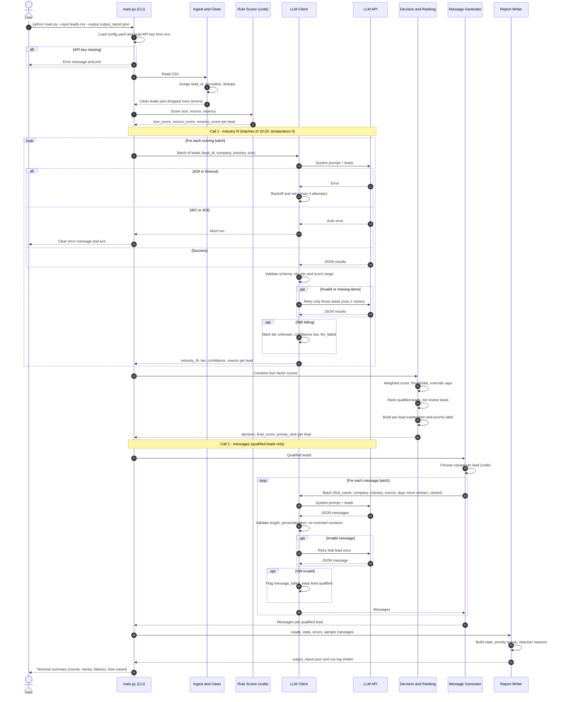

# Lead Intelligence System: Workflow (Operations & Supply Chain Software)

## 1. Purpose
Auto-qualify inbound leads, rank them for outreach, draft personalized first messages, and produce a report the sales team can act on. Borderline leads go to human review instead of being guessed.

## 2. Assumptions (state these in the README)
- **Company:** mid-market B2B SaaS company ("OpsFlow", a placeholder name).
- **Product:** operations software for physical-goods businesses: inventory tracking, warehouse and fleet visibility, demand and supply planning.
- **Ideal customer:** companies that move, make or sell physical goods, with 50-500 employees.
- **Input fields:** name, company, company_size, industry, source, last_interaction_date. No budget or timeline data exists, so those factors are not used.
- **Reference date:** the recency factor is measured against a configurable `reference_date` (the sample data spans Dec 2023 - Jan 2024, so use `2024-01-21`; default to today for real data).

### Definition of "Qualified" (our rubric, stated up front)
A lead is **Qualified** when it is a physical-goods business (best-fit industry), sized 50-500 employees, with a real buying signal (demo request, referral or sales call) and recent contact. The weighted score in Stage 4 is the measurable version of that sentence. Other businesses would define it differently (for example a SaaS vendor would treat SaaS as core); the point is that this rubric is stated once, applied the same way to every lead, and explained per lead.

### Ground truth and grading alignment
The provided data files contain **no expected outcomes**; there is no answer key and nothing to match. The work is judged on whether the rubric is clear, applied consistently, and defended per lead. The design therefore builds in:

| Grading criterion | How this design satisfies it |
|---|---|
| **Correctness** (scores make sense for the stated rubric) | Size, source and recency are deterministic code; the weighted formula is documented in `SCORING_WEIGHTS.md` and copied into every report |
| **Consistency** (same logic for similar leads) | Temperature 0, pinned model, cached industry results, order-invariance and rerun tests (section 8) |
| **Defensibility** (can explain each score) | Every lead carries an `explanation`: a factor-by-factor breakdown with points, the LLM's one-line industry reason, and any rule that capped the decision |
| **Clarity** (someone else can apply the rubric) | One-page README states the definition above, the four factors, weights, bands and thresholds |

### Data files and how each is used
| File | Rows | Use |
|---|---|---|
| `leads_training.csv` | 29 | Tune the industry prompt, check weights and thresholds. Nothing is "trained"; this is the prompt-iteration set |
| `leads_testing.csv` | 20 | Held-out edge cases (see section 8): `NA` values, blank source and date, unknown industry, solo and 50,000-person companies, stale and missing dates. Used to verify robustness, not to tune |
| `leads_full_scale_100.csv` | 100 | The final end-to-end run and the sample `output_report.json` |

## 3. Industry fit tiers
| Tier | Score | Industries (labels seen in the sample data) | Why |
|---|---|---|---|
| **Best fit** | 9-10 | Logistics, Supply Chain, Manufacturing, Retail, Automotive, Trade | Core need: moving and stocking physical goods |
| **Hard fit** | 4-6 | Construction, Energy, Agriculture, Healthcare, Environmental, Consumer | Some physical operations, but need is partial, regulated, or niche |
| **No fit** | 1-3 | Software, SaaS, Cybersecurity, AI/ML, Analytics, Finance, FinTech, Insurance, InsurTech, Cryptocurrency, Media, Entertainment, Telecom, Legal, Consulting, Marketing, Education, Government, NonProfit, Cultural, Hospitality, Events, Sports, Travel, Real Estate, Business Services, Services, Consumer Services, HR Tech, Climate Tech, HealthTech, Biotech, Pharmaceuticals | Little or no physical-goods operations |

**Name signal (LLM judgment):** the company name can move a lead one tier. Examples from the sample: "Logistics Optimization" (labeled Software) and "Supply Chain Analytics" (labeled Software) are *competitors or adjacent vendors*, not buyers, so the LLM should score them low and explain why. "Pharmaceutical Distribution" (labeled Healthcare) has real logistics needs, so it can move up to the hard-fit upper band.

Target spread on a balanced test file: roughly 20-30% best fit, 30-40% hard fit, 30-40% no fit.

## 4. Pipeline overview

```
leads.csv
   |
   v
[1 Ingest + Clean] --> bad rows --> errors[] in report
   |
   v
[2 Rule scoring (code)]   size, source, recency
   |
   v
[3 LLM scoring (batched)] industry fit + reason
   |        \--> invalid/failed items --> retry --> fallback: review
   v
[4 Decision + Ranking (code)] weighted score, thresholds, priority rank
   |
   v
[5 Message generation (LLM, batched)] qualified leads only
   |
   v
[6 Report] output_report.json + terminal summary + run.log
```

### Sequence diagram (complete run)



## 5. Stage details

### Stage 1: Ingest and clean
- Read the CSV; assign a unique `lead_id` (L001, L002, ...) to each row.
- Normalize: trim whitespace, parse dates, convert company_size to an integer.
- Row problems:
  | Problem | Action |
  |---|---|
  | Missing size or date | Keep lead, score that factor neutral (5), note "missing data" |
  | Missing name and company | Drop row, log in `errors[]` |
  | Duplicate (same name + company) | Keep the most recent, log the rest |
  | Unparseable date or size | Treat as missing |
  | Unknown source value (including the literal "Unknown Source") | Use the default source score (4) |
  | Placeholder text in any field (`NA`, `N/A`, `null`, `none`, blank, "Unknown", "Unknown Sector") | Treated as missing (case-insensitive) |
  | Missing company but other data present | Keep the lead; send company as "(missing)"; the industry label drives the fit |
  | Almost nothing usable (industry unknown and at least two of size, source, date missing) | Keep, flag `insufficient_data`; decision capped at `review` |

### Stage 2: Rule-based scoring (deterministic code)
| Factor | Weight | Bands |
|---|---|---|
| Company size fit | 25% | 50-500 = 10; 20-49 or 501-1000 = 7; 10-19 or 1001-5000 = 4; <10 or >5000 = 1; missing = 5 |
| Source quality | 20% | Inbound demo request 10; Referral 9; Sales call 8; Webinar attendee 6; Content download 5; LinkedIn outreach 3; unknown 4 |
| Engagement recency | 15% | <=14 days 10; <=30 days 7; <=90 days 4; older or missing 1 (measured from `reference_date`) |

All bands live in `config.yaml`, not in code.

**Implementation (factory pattern):** each factor is a `RuleScorer` subclass in `pipeline/rules.py` (`SizeRule`, `SourceRule`, `RecencyRule`), registered by name with `@register_rule`. `RuleFactory.create_all(config["rules"])` builds the scorers listed under `rules:` in `config.yaml`. To add an attribute rule, write one new class and add one config entry; no other code changes. Every rule returns a score (1-10) and a short `detail` that feeds the per-lead explanation.

### Stage 3: LLM scoring (batched)
- **Factor:** industry fit (weight **40%**, the largest because it separates buyers from non-buyers in this product).
- Input per lead: `lead_id`, company, industry label, company size.
- The prompt contains the tier table from section 3 and the name-signal rule.
- Output per lead: `{"lead_id": "L001", "industry_fit": 9, "tier": "best", "confidence": "high", "reason": "<max 20 words>"}`. The `unknown` tier (score 5) and the `confidence` field are used when the label and name do not make the business clear; full prompt text is in `LOW_LEVEL_DESIGN.md`.
- Settings: batch of 10-20 leads, temperature 0, JSON mode or schema, results keyed by `lead_id`.
- Validation: every id present, integer score 1-10 inside the tier's range, tier in {best, hard, none, unknown}, confidence in {high, medium, low}, reason present.
- Failure handling:
  - Invalid or missing items: retry only those, up to 2 times.
  - Timeout or rate limit (429): exponential backoff with jitter.
  - Still failing: mark the lead `review` with reason "LLM scoring failed"; the run continues.

### Stage 4: Decision and ranking (code)
- `final_score = 0.40*industry + 0.25*size + 0.20*source + 0.15*recency` (range 1-10).
- Thresholds (tune on the test data):
  - `>= 7.0` qualified
  - `5.0 - 6.9` review
  - `< 5.0` rejected
- **Override rule:** if industry tier is `none`, cap the decision at `review` at most, and if size is also <10 or >5000, force `rejected`. This stops strong source or recency scores from pushing a wrong-industry lead into the queue.
- **Additional caps (at most `review`):** industry tier `unknown`, LLM confidence `low`, `insufficient_data`, or no contact for more than 180 days (a stale lead needs re-validation before outreach).
- Priority rank: qualified leads sorted by score, ties broken by most recent interaction. Review leads are listed separately, also sorted by score.
- Priority label for qualified leads: `HIGH` (score 8.5 and above) or `MEDIUM` (7.0 to 8.49). Review and rejected leads have no priority label.
- Rejection reason = the lowest-scoring factor(s), used for the "common rejection reasons" stat.
- **Explanation (code-generated, deterministic):** for every lead, build text such as
  ```
  Lead: Alice Chen, CloudScale AI (50 people, SaaS, Inbound demo request, 6 days ago)
  Score: 6.8/10  Decision: REVIEW
    Industry fit  (40%): 2/10 -> 0.80 pts  "AI software company; no physical-goods operations."
    Company size  (25%): 10/10 -> 2.50 pts  (50 employees, target range)
    Lead source   (20%): 10/10 -> 2.00 pts  (inbound demo request)
    Engagement    (15%): 10/10 -> 1.50 pts  (6 days since contact)
    Rule applied: industry tier "none" caps the decision at review.
  ```
  Explanations are assembled by code from the factor scores, so they are consistent and cannot contradict the decision. The LLM contributes only the one-line industry reason.
- **Consistency controls:** industry results are cached by the normalized key (company, industry, size) so identical inputs always get the same tier within and across runs; batch order does not change a lead's result (tested in section 8).

### Stage 5: Message generation (batched LLM)
- Only for qualified leads, in a separate call from scoring.
- Input: name, company, industry, size, source, last interaction.
- Three variants chosen by situation:
  | Variant | Used when | Angle |
  |---|---|---|
  | Warm follow-up | Source is Inbound demo request or Referral | Reference the request or referrer, offer a demo slot |
  | Value-led | Content download, Webinar, Sales call | Tie to a pain point in their industry (stockouts, delivery delays, manual tracking) |
  | Re-engagement | Last interaction older than 30 days | Acknowledge the gap, share one relevant proof point |
- Each message references at least one specific lead detail (company, industry, or source), max about 80 words, no invented facts or statistics.

### Stage 6: Report
`output_report.json`:
```
{
  "run_info":   { timestamp, model, batch_size, reference_date, duration_sec,
                  rubric { definition, weights, bands, thresholds, caps } },
  "stats":      { total, processed, qualified_pct, review_pct, rejected_pct,
                  top_rejection_reasons[], by_industry_tier{}, api_retries,
                  failed_leads, est_manual_minutes_saved },
  "leads":      [ { lead_id, name, company, factor_scores{}, factor_points{},
                    final_score, decision, priority, priority_rank,
                    explanation, flags[], message } ],
  "priority_queue": [ lead_ids in order ],
  "sample_messages": [ 3-5 examples across the variants ],
  "errors":     [ dropped rows, failed calls ]
}
```
Also print a short summary in the terminal and write details to `run.log`.

## 6. Project structure
```
lead-qualifier/
  main.py            CLI entry (argparse): --input --output --batch-size --reference-date
  config.yaml        weights, bands, thresholds, tier table, model settings
  pipeline/          ingest.py, rules.py, llm.py, decide.py, messages.py, report.py
  data/              leads_training.csv, leads_testing.csv, leads_full_scale_100.csv
  output_report.json sample output (from the 100-lead file)
  README.md          1 page
  .env.example       API key placeholder (never commit real keys)
```

## 7. Build plan (about 8-10 hours)
| Step | Task | Time |
|---|---|---|
| 1 | Finalize product, tiers, weights, thresholds in config.yaml | 1 h |
| 2 | Place the three provided data files; review the testing file's edge cases and decide handling | 1 h |
| 3 | Ingest/clean and rule scoring | 1.5 h |
| 4 | LLM client: batching, JSON validation, retries, fallback | 2 h |
| 5 | Tune the industry prompt on `leads_training.csv`, then check `leads_testing.csv` untouched | 1 h |
| 6 | Decision, override rule, ranking, message generation | 1.5 h |
| 7 | Report, logging, README | 1 h |
| 8 | Full run, failure tests | 0.5 h |

## 8. Test checklist
There is no answer key (see section 2). The checks below test **crashes, consistency and defensibility**, not agreement with a ground truth.

### 8.1 Run and robustness
- `leads_full_scale_100.csv` (100 leads) runs end to end with no crash and no manual step.
- `leads_testing.csv` (20 edge cases) runs with no crash; every row gets a decision or a logged drop.
- Simulated API failure (wrong key or offline) produces a report with leads marked review, not a crash. A 401 stops the run with a clear message.

### 8.2 Consistency
- **Rerun test:** two runs on the same file give identical scores and decisions.
- **Order test:** shuffle the CSV rows; every lead keeps the same tier and score.
- **Twin test:** leads with identical size band, source, recency band and industry tier get identical final scores.
- **Label-variant test:** "Software", "SaaS" and "Enterprise Software" all land in the same tier.

### 8.3 Defensibility
- Every lead has a non-empty `explanation` whose factor points add up to the `final_score`.
- Every decision that was capped shows the cap rule in its explanation.
- No explanation reads like "seems like a good lead": each cites the factor values it used.

### 8.4 Edge cases in `leads_testing.csv`
Expected results below are computed by hand from our own weights and thresholds (reference date 2024-01-21, industry tier as the LLM is expected to assign). They are **sanity expectations from our rubric, not ground truth**; if the LLM tier differs, the explanation must still make the result defensible.

| Test lead | Situation | Expected decision | Why |
|---|---|---|---|
| Test_MissingSize | Size is `NA`, SaaS | Review (5.55) | Size scores neutral 5; SaaS is a no-fit industry, capped at review |
| Test_VeryLargeEnterprise | 50,000 employees, Enterprise Software | Rejected (4.55) | No-fit industry and size over 5,000 |
| Test_Solo | 1 employee, Consulting | Rejected (3.15) | No-fit industry and size under 10 |
| Test_StaleInteraction | Manufacturing, 100 employees, last contact June 2022 | Review (8.25 before the stale cap) | Score would qualify, but no contact for over 180 days caps it at review |
| Test_RecentEngagement | SaaS, 200 employees, demo request yesterday | Review (6.8) | Strong intent cannot outweigh a no-fit industry |
| Test_MissingDate | Blank source and date, "Technology" | Not qualified | Source 4, recency 1; tier none or unknown, both capped |
| Test_UnknownIndustry | "Unknown Sector", 15 employees, referral | Review (6.3) | Industry unknown (score 5) caps at review |
| Test_VeryRecentSignup | 2 employees, SaaS | Rejected (4.55) | No-fit industry and size under 10 |
| Test_MultipleInteractions | Finance, 500 employees, demo request | Review (6.8) | No-fit industry caps the decision |
| Test_NoSourceInfo | Retail, 300 employees, "Unknown Source" | Qualified HIGH (8.8) | Best-fit industry; source defaults to 4 |
| Test_HighValueMatch | SaaS, 2,000 employees, name says "Perfect Fit" | Review (5.3) | Promotional words in a name are ignored; no-fit industry |
| Test_LowValueNiche | Agriculture, 5 employees | Rejected (3.95) | Hard-fit industry but size under 10 |
| Test_MissingName | Blank company, Consulting, 400 employees | Review (6.4) | Company "(missing)"; label gives no-fit tier, capped |
| Test_NameOnly | Name only; every other field `NA` | Review, flag `insufficient_data` | Nothing to score; human should enrich the record |
| Test_PartialData | Size `NA`, blank source, SaaS | Rejected (4.35) | No-fit industry plus weak data |
| Test_WeekOldInteraction | Logistics, 250 employees, webinar | Qualified HIGH (9.2) | Best fit on every factor |
| Test_MidMarketSoft | SaaS, 1,500 employees, content download | Rejected (4.3) | No-fit industry, size outside target |
| Test_StartupShutdown | SaaS, 8 employees, contact May 2023 | Rejected (3.0) | No-fit industry, tiny, stale |
| Test_GovernmentBuyer | Government, 3,000 employees | Rejected (4.9) | No-fit industry; just under the review line |
| Test_SMBAverage | Retail, 120 employees, demo request | Qualified HIGH (10.0) | Best fit on every factor |

### 8.5 Messages
- Every message mentions a specific lead detail (company, industry or source) and matches its variant.
- No message contains a number or claim that is not in the lead's data.

## 9. Known limitations (for README)
- Industry fit depends on LLM judgment, so borderline labels may vary slightly between runs.
- Weights and thresholds are assumptions, not learned from conversion data.
- Industry labels are free text, so unseen labels rely on the LLM's mapping to the tiers.
- Free-tier rate limits cap the run speed.
- There is no ground truth, so correctness means "consistent with the stated rubric", not "matches what actually converted".
- The rubric reflects one business definition (operations software). A different product would qualify different leads, for example SaaS leads that this rubric sends to review.
